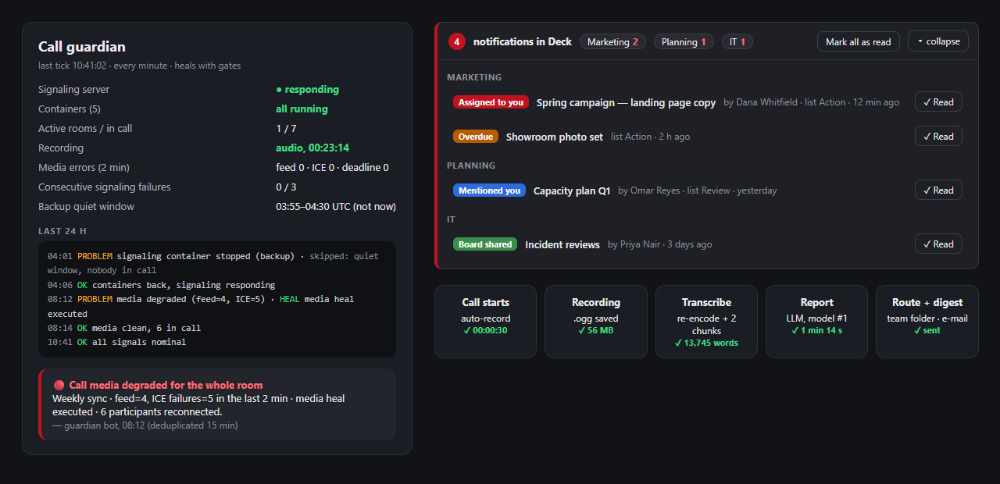

# Nextcloud Ops Robots

Self-healing automation around a self-hosted **Nextcloud** (AIO on Docker) used for calls, boards and files by a mid-size company: a **call guardian** that measures real signals and repairs the stack with gates, a **recording → transcription → report** pipeline for meetings, **UI injections** that make Deck notifications actionable, and host-level **reconcile loops** that survive container recreation.

> Curated excerpt. No hostnames, credentials, people or company data; the screenshot is a mock with fictitious values.



## What runs where

```mermaid
flowchart TB
  subgraph Host (cron)
    G[Call guardian<br/>every minute]
    R[Auto-record<br/>every 30 s]
    X[Transcription rescue<br/>chunked Whisper]
    P[Meeting report<br/>LLM + fallback chain]
    M[Committee digest<br/>e-mail]
    H[Reconcile loop<br/>hosts, runtime, SDK]
  end
  subgraph Containers
    NC[(Nextcloud)]
    HPB[Signaling / HPB]
    REC[Recording server]
  end
  G -- docker logs, API, DB --> HPB & NC
  G -- docker start / restart (gated) --> HPB & REC
  R -- OCC --> NC
  NC -- call ended --> REC -- .ogg --> X -- transcript.md --> P -- report.md --> NC
  P --> M
  H -- docker exec --> NC
  G -- alert (dedup 15 min) --> Bot[Talk bot]
```

## The call guardian

Earlier monitors read the application log and missed real outages: the signaling server fails quietly, and the symptoms live in **its** log ("no such feed", ICE candidate failures, context deadlines). The guardian measures five things every minute — container state, signaling welcome endpoint, active rooms/participants, media-error counters over the last two minutes, and recording status — then heals with **gates** so that it never makes a bad moment worse:

- a stopped container is started immediately (nothing to confirm);
- degraded media triggers the media heal at once;
- a dead signaling server is restarted only after **three consecutive** failures;
- nothing is touched during the nightly backup window unless someone is in a call;
- every alert is deduplicated for 15 minutes and sent to a chat bot with the exact signal that fired.

```python
# gate: restart only after N consecutive failures, never during the backup window
def maybe_restart(state, signaling_ok, in_call, now):
    state["sig_fail"] = 0 if signaling_ok else state.get("sig_fail", 0) + 1
    if state["sig_fail"] < 3:
        return "wait", state["sig_fail"]
    quiet = (now.hour == 3 and now.minute >= 55) or (now.hour == 4 and now.minute < 30)  # UTC backup window
    if quiet and not in_call:
        return "skip-backup-window", state["sig_fail"]
    state["sig_fail"] = 0
    return "restart", 3
```

The guardian's state file is read by a separate dashboard worker, so the same measurement feeds the on-call view and the chat alerts.

## Recording → transcript → report

1. **Auto-record**: when a call starts in a room that opts in, an OCC command starts the recording on behalf of a moderator (audio-only when video is blocked).
2. **Transcribe**: the hosted Whisper endpoint accepts 25 MB per request. Long meetings are re-encoded to mono/16 kHz Opus and, if still too big, split by duration; chunks are transcribed in order and concatenated.
3. **Report**: an LLM turns the transcript into a fixed-section report (summary, topics, problems, decisions, actions) saved next to the recording and routed to the team folder. Providers retire models without notice, so the model is a **list** with automatic fallback.
4. **Digest**: committee meetings additionally produce a short e-mail (agreed / next steps / for next meeting) rendered as HTML.

```python
# keep every chunk under the provider's upload limit without cutting words mid-air
LIMIT = 24 * 1024 * 1024          # a little under 25 MB
CHUNK_SECS = 600

def chunks_for(path):
    small = reencode(path, ac=1, ar=16000, codec="libopus", bitrate="24k")   # ~3 MB per 10 min
    if os.path.getsize(small) <= LIMIT:
        return [small]
    total = duration_seconds(small)
    return [cut(small, start, min(CHUNK_SECS, total - start))
            for start in range(0, int(total), CHUNK_SECS)]

def transcribe(path):
    return "\n".join(whisper(c, language="pt") for c in chunks_for(path))
```

```python
# model list with silent fallback: the next model takes over when one is retired
MODELS = ["provider/large-model", "provider/mid-model", "provider/small-model"]

def complete(prompt):
    for model in MODELS:
        r = chat(model, prompt)
        if r.ok:
            return r.text
        if r.error_code in ("model_not_found", "model_decommissioned"):
            continue                       # try the next one
        raise RuntimeError(r.error)
    raise RuntimeError("no model available")
```

## "Where is the notification?" (Deck)

The bell says *"3 notifications in Deck"* but not on which board or card. A small script injected server-side (so it works in the browser and in the desktop app) groups Deck notifications by board, shows a strip at the top of the app with one row per card (type, card, who, when, "open", "mark as read"), paints a counter on each board in the sidebar and highlights the cards themselves. Opening a card marks its notifications as read through the API.

The painter is **idempotent** — it only adds what is missing, updates text that changed and removes what is stale. The first version redrew everything every two seconds and the badges *blinked*; this one never does.

```js
// paint counters on sidebar boards without flicker: add missing, update changed, remove stale
function paintBoards(countByBoard) {
  for (const a of document.querySelectorAll('nav a[href*="/board/"]')) {
    const id = a.getAttribute('href').match(/\/board\/(\d+)/)?.[1];
    const n = countByBoard[id] || 0;
    let badge = a.querySelector('.badge');
    if (n === 0) { badge?.remove(); continue; }
    if (!badge) { badge = document.createElement('span'); badge.className = 'badge'; a.appendChild(badge); }
    const txt = n > 9 ? '9+' : String(n);
    if (badge.textContent !== txt) badge.textContent = txt;   // touch the DOM only on change
  }
}
```

## Reconcile loops (things that survive upgrades)

Container recreation after an AIO upgrade silently removed `python3`, the extra `/etc/hosts` entries and the vendored SDKs that the robots depend on. Instead of fixing by hand each time, a 5-minute cron **reconciles**: it checks each expectation (`command -v python3`, a hosts entry, an importable module) and re-applies only what is missing. The same pattern re-pins a mail host whose DNS entry on the host was stale.

## Lessons learned (the expensive kind)

- Read the log of the component that fails, not the one that is convenient — the signaling server's log told the truth; the application log was quiet.
- A Python script piped into a container over stdin breaks on newer interpreters ("`[` was never closed" at a line that is fine). Copy the file in, run it from disk.
- Nextcloud's *activity* for a deletion fires **before** the delete; the entry proves an attempt, not a result.
- Bumping an app's `version` in `info.xml` puts the whole instance in "update needed" mode; bust client caches with the theming cache-buster instead.
- API providers retire models without warning: a hard-coded model name is an outage waiting to happen.
